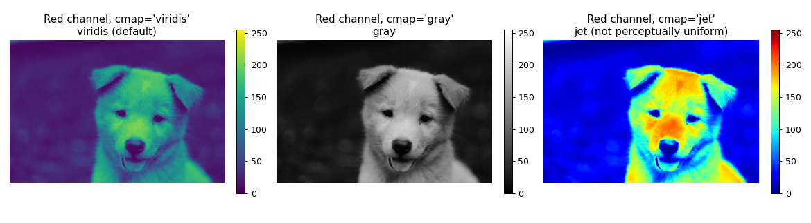
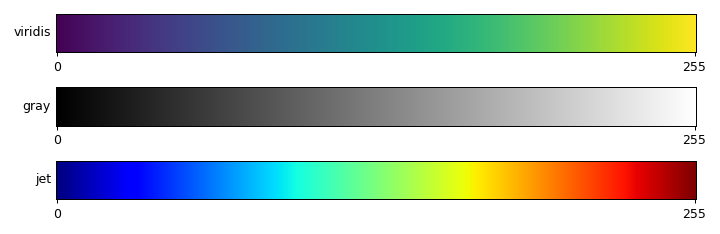

# Colormaps

## Definition (in my own words)
A colormap (`cmap`) translates **one number per pixel** into a color on screen. matplotlib needs it when we show a 2D array (one channel, grayscale, a heatmap). A 3-channel RGB array does not use a colormap; its colors are already there.

## Why it came up
```python
plt.imshow(pic_red[:,:,0])                # default -> viridis (purple to yellow)
plt.imshow(pic_red[:,:,0], cmap='gray')   # black (0) to white (255)
```
The data is the same, only the display changes.

## Comparison on the same channel




| Colormap | Type | Pros | Cons |
|---|---|---|---|
| `viridis` (default) | perceptually uniform, sequential | equal steps in value look like equal steps in color; readable for color-blind people and in grayscale print | looks "fake" for a real photo |
| `gray` | sequential | natural for image intensity; brightness = value | small differences are harder to see |
| `jet` | rainbow, **not** perceptually uniform | high contrast, looks dramatic | creates false edges: the yellow/cyan bands look like sharp borders even where values change smoothly (see the puppy's face) |

## Key terms
- **Sequential colormap:** shows data that goes from low to high with one steady progression of color.
- **Perceptually uniform:** the human eye sees the change between colors as even across the whole range, so the picture is an accurate representation of the data.
- **viridis:** matplotlib's default; goes from dark purple/blue through green to yellow.

## Rule of thumb
- Real image channels → `cmap='gray'`
- Data / heatmaps (e.g. a depth map or an error map later in the course) → `viridis` or another perceptually uniform map
- Avoid `jet` for anything you want to measure by eye

## Used in
- Code: `Code/02-02-images-as-numpy-arrays.ipynb`
- [[Week 01 - Digital Image Basics]]

## Related
- [[RGB Color Channels]]
- [[Image as a NumPy Array]]
