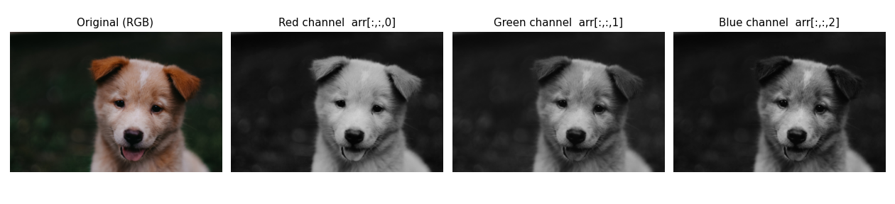
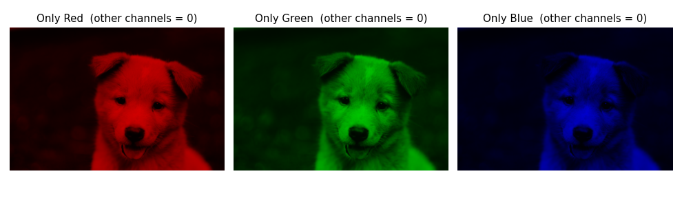

# RGB Color Channels

## Definition (in my own words)
A color image stores three separate grayscale layers, one per primary color. Each pixel's final color is the mix of its Red, Green and Blue values (each 0–255).

| Index | Channel (PIL / matplotlib) |
|---|---|
| `img[:,:,0]` | Red |
| `img[:,:,1]` | Green |
| `img[:,:,2]` | Blue |

> ⚠️ OpenCV reads images in **BGR** order, so index 0 is Blue there. This will matter from Section 3 on (`cv2.cvtColor(img, cv2.COLOR_BGR2RGB)`).

## Each channel as a grayscale image


Bright = a lot of that color, dark = little of it.
- The **orange ears** are very bright in the red channel and almost black in the blue channel → orange = high red, low blue.
- The **white patch** on the forehead is bright in all three channels → white = high R, G and B.
- The **background** is dark everywhere, slightly brighter in green → a dark green background.
- Average values of this photo: R ≈ 57, G ≈ 52, B ≈ 44 → overall a warm (reddish), dark image.

## Isolating a channel ("zero out" the others)
```python
pic_red = pic_arr.copy()
pic_red[:, :, 1] = 0   # remove green
pic_red[:, :, 2] = 0   # remove blue  -> only red is left

pic_blue = pic_arr.copy()
pic_blue[:, :, :2] = 0 # remove red and green in one slice (indices 0 and 1)
```


## Comparison: two ways to "show a channel"
| | `plt.imshow(img[:,:,0], cmap='gray')` | zero out other channels, `plt.imshow(img)` |
|---|---|---|
| Array shape | 2D `(H, W)` | 3D `(H, W, 3)` |
| Shown as | brightness (gray) | the color itself (red tones) |
| Best for | comparing how strong a color is | an intuitive "only red" look |

## Used in
- Code: `Code/02-02-images-as-numpy-arrays.ipynb` (red), `Code/02-03-numpy-and-image-assessment.ipynb` (blue)
- [[Week 01 - Digital Image Basics]]

## Related
- [[Image as a NumPy Array]]
- [[Colormaps]]
