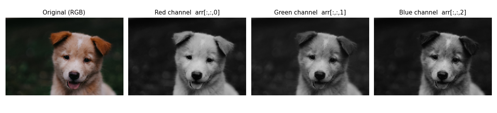

# Week 01 - Digital Image Basics

## 🎯 Goal
Pixels, color spaces (RGB/HSV/Lab), channels, images as NumPy arrays.

**Output:** A notebook that loads an image, splits it into channels and converts color spaces.

## 📚 Source
Udemy – *Python for Computer Vision with OpenCV and Deep Learning* (Jose Portilla)

| Section | Status |
|---|---|
| 1 · Course Overview | ✅ done |
| 2 · NumPy and Image Basics | ✅ done |
| 3 · Image Basics with OpenCV | ⏳ next (color spaces, `cv2.imread`, BGR vs RGB, drawing on images) |

## 📝 Notes
- An image is just a NumPy array of shape `(height, width, channels)` with dtype `uint8` (0–255).
- Shape is always **rows first**: `(H, W)` → pixels are accessed as `img[y, x]`.
- A slice is a **view**: changing it changes the original. Use `.copy()` before editing.
- `np.asarray(PIL_image)` gives a **read-only** array → another reason to `.copy()`.
- Channel order in PIL / matplotlib is R, G, B (index 0, 1, 2). OpenCV will use **BGR**.
- A single channel is 2D, so `plt.imshow` applies a colormap; default is viridis, use `cmap='gray'` for real intensity.

## 🔑 Concepts
- [[NumPy Arrays]]
- [[Image as a NumPy Array]]
- [[RGB Color Channels]]
- [[Colormaps]]

## 💻 Code / Output
- `Code/02-01-numpy-arrays.ipynb`: array creation, random numbers, max/argmax, reshape, slicing, view vs copy
- `Code/02-02-images-as-numpy-arrays.ipynb`: open the puppy image, inspect the shape, show each channel, isolate red
- `Code/02-03-numpy-and-image-assessment.ipynb`: section assessment, isolate the blue channel ✅

## ❓ Questions
- Why is `np.asarray(pic)` read-only but `np.array(pic)` writable? → `asarray` avoids copying when it can and shares memory with the PIL image; `np.array` always makes a new, writable array.
- 

## ✅ Summary of the week
- Sections 1–2 done (Nov 28, ahead of schedule).
- Next: Section 3, Image Basics with OpenCV.
